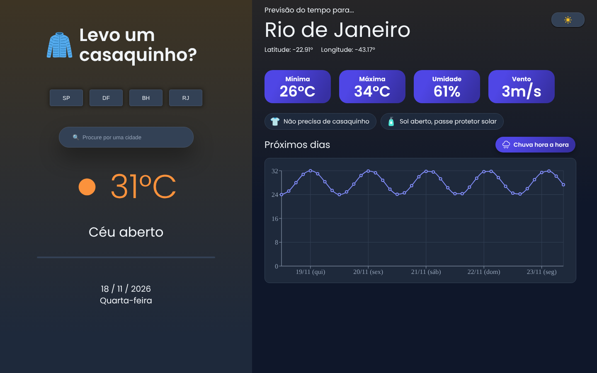
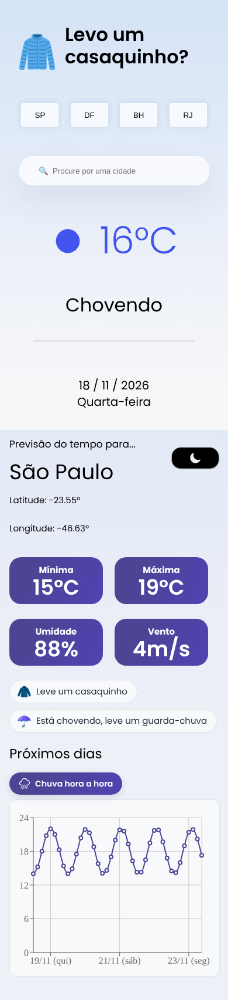

# Levo um casaquinho? 🧥

Um app de previsão do tempo que responde a pergunta de todo dia antes de sair de casa: **o que eu preciso levar?**

Em vez de deixar você interpretar números soltos, o app olha a temperatura, o céu agora e a chance de chuva nas próximas horas e diz direto: leve um casaquinho, leve um guarda-chuva, passe protetor solar ou pegue touca e luvas.

🔗 **Acesse:** [projeto23-leve-um-casaco.vercel.app](https://projeto23-leve-um-casaco.vercel.app/)


> As imagens deste README usam dados de exemplo.

## Que problema ele resolve

**1. Decidir o que levar sem precisar interpretar a previsão.**
A maioria dos apps de clima mostra 17 °C, 60% de chance de chuva e índice UV alto e deixa a conclusão com você. Aqui o app transforma esses números em recomendações claras, em forma de etiquetas:

| Recomendação | Quando aparece |
|---|---|
| 🧥 Leve um casaquinho | 17 °C ou menos, ou nevando |
| 👕 Não precisa de casaquinho | acima de 17 °C |
| ☂️ Leve um guarda-chuva | chovendo, garoando ou com tempestade agora, ou com 50% ou mais de chance de chuva nas próximas 12 horas |
| 🧴 Passe protetor solar | céu aberto ou poucas nuvens, durante o dia (entre o nascer e o pôr do sol da cidade) |
| 🧣 Touca e luvas | nevando ou 5 °C ou menos |

**2. Saber *quando* vai chover e *quanto*.**
"70% de chance de chuva hoje" não diz se a chuva vem de manhã ou à noite, nem se é garoa ou temporal. O botão **Chuva hora a hora** mostra, para cada hora dos próximos 16 dias (até 384 horas), a probabilidade de chuva e os milímetros previstos. Assim dá para planejar o horário de sair, um treino ao ar livre ou uma viagem.

**3. Entender o tempo num relance.**
A cor do fundo e da temperatura mudam conforme o tempo: tons quentes no sol, azul na chuva, cinza no nublado, lilás na tempestade, azul-gelo na neve. Você percebe como está o dia antes mesmo de ler.

**4. Consultar qualquer cidade rapidamente, no horário de lá.**
Basta buscar pelo nome ou usar os atalhos SP, DF, BH e RJ. Datas e horários dos gráficos ficam sempre no fuso da cidade pesquisada, não no seu.

## Como funciona na prática

### 1. Escolha a cidade

Ao abrir, o app mostra Manaus. Digite o nome de qualquer cidade do mundo na busca e aperte Enter, ou toque num dos atalhos (SP, DF, BH, RJ). Se a cidade não existir, aparece um aviso pedindo outra.

### 2. Veja o tempo agora

- **Painel esquerdo:** temperatura atual, a condição do céu (céu aberto, nublado, chovendo, tempestade, neve, neblina...) e a data. O fundo ganha um tom claro de acordo com o tempo.
- **Painel direito:** mínima, máxima, umidade e vento, e logo abaixo as etiquetas do que levar.

### 3. Acompanhe os próximos dias

O gráfico **Próximos dias** mostra a temperatura dos próximos 5 dias, de 3 em 3 horas. Passe o mouse ou toque num ponto para ver a temperatura daquele horário.

### 4. Abra a chuva hora a hora


Toque em **Chuva hora a hora** para abrir a janela com:

- **Atalhos de período:** 24h, 48h, 7 dias ou 16 dias. Abre em 48h.
- **Resumo do período escolhido:** maior chance de chuva e quando, chuva acumulada e a hora mais chuvosa.
- **Dois gráficos alinhados pela hora:** probabilidade de chuva (%) em cima e milímetros previstos embaixo. Ao passar o dedo ou o mouse, aparece a hora com a chance e os milímetros.
- **Barra de seleção:** mostra os 16 dias inteiros em miniatura; arraste a área destacada para ver outras horas ou estique as bordas para ver mais ou menos tempo.
- **Tabela:** troque para a visualização em tabela para ler hora por hora.

### 5. Escolha o tema

O botão no canto superior direito alterna entre o tema claro e o escuro. As cores do tempo acompanham o tema.



### No celular

O layout se adapta a telas pequenas: os painéis ficam um embaixo do outro, os cartões quebram em duas colunas e a janela de chuva ocupa quase a tela toda.



## De onde vêm os dados

| Fonte | O que fornece | Chave |
|---|---|---|
| [OpenWeatherMap](https://openweathermap.org/api) | tempo atual e previsão de 5 dias de 3 em 3 horas (temperatura, céu, umidade, vento e chance de chuva) | precisa de chave gratuita |
| [Open-Meteo](https://open-meteo.com/) | probabilidade de chuva e milímetros previstos, hora a hora, por até 16 dias | não precisa de chave |

Se a Open-Meteo estiver fora do ar, a janela de chuva usa a previsão de 3 em 3 horas do OpenWeatherMap e avisa que os dados estão menos detalhados.

## Tecnologias

- React 18 + Vite
- Styled-Components
- Recharts (gráficos)
- Axios
- SweetAlert2 (avisos de erro)
- Ionicons

## Como rodar o projeto

1. Clone o repositório:

```bash
git clone https://github.com/PedroGomes2k/projeto23-Leve-Um-Casaco.git
cd projeto23-Leve-Um-Casaco
```

2. Instale as dependências (requer Node.js 26):

```bash
npm install
```

3. Configure a chave da API:

- Crie uma conta gratuita no [OpenWeatherMap](https://openweathermap.org/api) e gere uma API key.
- Copie o arquivo `.env.example` para `.env` e coloque a sua chave em `VITE_API_KEY`.

A Open-Meteo não precisa de configuração.

4. Rode o projeto:

```bash
npm run dev
```

Para testar no celular, rode `npm run dev -- --host` e abra no celular o endereço "Network" que o Vite mostrar, com o celular no mesmo Wi-Fi do computador.

Outros comandos: `npm run build` (build de produção), `npm run preview` (serve o build) e `npm run lint`.

## Estrutura do projeto

```
src/
├── App.jsx                       # carrega a cidade inicial e monta os dois painéis
├── Contex/Contex.jsx             # tema claro/escuro
├── Componentes/
│   ├── Weather/                  # painel esquerdo: busca, atalhos, temperatura e fundo do tempo
│   │   ├── findCity.js           # busca o tempo atual e a previsão no OpenWeatherMap
│   │   └── colorsOfWaether.js    # cores e tons de fundo de cada tipo de tempo
│   ├── Forecast/                 # painel direito: cartões, o que levar e gráfico dos próximos dias
│   │   └── whatToTake.js         # regras do que levar
│   └── Rain/                     # janela "Chuva hora a hora"
│       ├── findRain.js           # busca a chuva hora a hora na Open-Meteo (e o plano B)
│       ├── RainCharts.jsx        # gráficos de probabilidade e milímetros
│       └── RainTable.jsx         # visualização em tabela
└── erros/cantFindCity.js         # avisos de cidade não encontrada e falha ao carregar
```

## Deploy

O projeto está publicado na Vercel: [projeto23-leve-um-casaco.vercel.app](https://projeto23-leve-um-casaco.vercel.app/). Cada branch enviada ao GitHub ganha um link de preview para testar antes de ir para a `main`.

#

Agora você pode sair de casa sabendo exatamente o que levar! ☁️☂️🧥
